<p align="center">
  
</p>

<p align="center">
  <a href="https://github.com/ishandutta2007/Awesome-Awesome-Awesome"></a><a href="https://discord.gg/jc4xtF58Ve"></a>
  <a href="https://github.com/ishandutta2007/Awesome-Aweoome-Awesome"></a>
  <a href="https://github.com/ishandutta2007/Awesome-Federated-Learning-Privacy/stargazers"></a>
  <a href="https://github.com/ishandutta2007/Awesome-Federated-Learning-Privacy/blob/main/LICENSE"></a>
  <a href="https://github.com/ishandutta2007/Awesome-Federated-Learning-Privacy/pulls"></a>
  <a href="https://github.com/ishandutta2007/Awesome-Federated-Learning-Privacy"></a>
  <a href="https://github.com/ishandutta2007"></a>
</p>

---

# 🛡️ Awesome Federated Learning & Privacy

> 🌐 A meticulously curated catalog of enterprise **SaaS platforms**, production **open-source frameworks**, and **privacy-preserving technologies** powering decentralized AI, collaborative machine learning, and confidential computing.

**Federated Learning (FL)** and **Privacy-Preserving Machine Learning (PPML)** empower multiple autonomous institutions to train shared artificial intelligence models without centralizing raw datasets. This paradigm protects sensitive records and guarantees data sovereignty across highly regulated sectors such as **healthcare (HIPAA, HITECH)**, **finance (BFSI, PCI-DSS)**, and **cross-border enterprise analytics (GDPR, CCPA)**.

---

## 📑 Table of Contents

- [📈 Sector Overview & Market Dynamics](#-sector-overview--market-dynamics)
- [☁️ SaaS & Hosted Enterprise Platforms](#️-saas--hosted-enterprise-platforms)
- [🔓 Open-Source GitHub Projects](#-open-source-github-projects)
  - [⭐ Open-Source Ecosystem Ranking](#-open-source-ecosystem-ranking)
  - [🔍 Deep-Dive: Open-Source Frameworks](#-deep-dive-open-source-frameworks)
- [🛡️ Privacy Taxonomy & Security Primitives](#️-privacy-taxonomy--security-primitives)
- [🤝 How to Contribute](#-how-to-contribute)
- [💖 Support](#-support)
- [⭐ Star History](#--star-history)
- [📜 Disclaimer & Compliance Notice](#-disclaimer--compliance-notice)

---

## 📈 Sector Overview & Market Dynamics

> 💡 **Market Size & Growth:** The global **Federated Learning market** was valued at approximately **$135M–$150M in 2024** and is projected to reach **$315M–$450M+ by 2030**, advancing at a Compound Annual Growth Rate (CAGR) of **11%–14%** (with specialized Privacy-Enhancing Computation & Confidential AI segments expanding at upwards of **28%–33%**).
>
> 🧩 **Market Concentration:** The sector remains **moderately to highly fragmented** rather than exhibiting a winner-take-all monopoly. Foundational hardware acceleration, secure enclaves, and enterprise infrastructure are anchored by hyperscalers and semiconductor leaders (NVIDIA, IBM, Intel, Google), while multi-institutional orchestration, clinical trials, and regulatory governance layers are led by specialized vertical pure-plays (Owkin, Rhino Health, Apheris, Flower Labs).

---

## ☁️ SaaS & Hosted Enterprise Platforms

The table below catalogs managed cloud services and enterprise platforms supporting federated AI, privacy-preserving computation, and edge observability. 

*Sorted in descending order of **Company Scale / Valuation**.*

| 🏢 Platform / Vendor | 📊 Company Scale / Valuation | 💰 Pricing (Starting Tiers) | 🎁 Free Tier & Trial Limits | 🎯 Key Focus & Compliance |
| :--- | :--- | :--- | :--- | :--- |
| **[NVIDIA Clara](https://www.nvidia.com/en-us/clara/)** <br><sub>(via NVIDIA AI Enterprise)</sub> | **~$3.0 Trillion** Market Cap <br>*(Revenue: ~$60.9B+)* | **$4,500 / GPU / year** subscription <br>*(or **$1.00 / GPU-hour** on CSP cloud marketplaces)* | **90-Day Free Trial** via NVIDIA LaunchPad with access to accelerated GPU clusters, Clara imaging pipelines & FLARE labs | Enterprise healthcare AI platform integrating NVIDIA FLARE for multi-hospital diagnostic imaging and genomics consortia. |
| **[IBM Federated Learning](https://www.ibm.com/products/federated-learning)** <br><sub>(IBM Cloud Pak for Data)</sub> | **~$210 Billion** Market Cap <br>*(Revenue: ~$62.0B)* | **$1,050 / month** for Cloud Pak for Data / watsonx Standard Tier <br>*(or pay-as-you-go from **$0.60 / Resource Unit / hour**)* | **30-Day Free Trial** (includes 1 Resource Unit, 25 GB Object Storage Lite, 300,000 foundation tokens & 20 Compute Usage Hours) | Enterprise data governance hub, hybrid cloud orchestration, and vertical/horizontal FL within watsonx.ai. |
| **[Owkin](https://www.owkin.com/)** | **$1.2 Billion** Valuation <br>*(Unicorn; $300M+ raised from Sanofi & BMS)* | Enterprise consortium contracts from **$150,000 / year** <br>*(Single biomarker discovery pilots start from **$50,000 / project**)* | **30-Day Sandbox Pilot** for accredited hospital & academic research labs (limited to 2 federated nodes and 50 GB dataset cap) | AI biotech & clinical trial optimization using federated consortia for oncology, pathology, and drug discovery. |
| **[EdgeDelta](https://edgedelta.com/)** | **~$300 Million** Valuation <br>*(Series B; $63M raised from Menlo Ventures)* | Telemetry pipelines at **$0.00 / GB** (Free); Platform search & storage from **$0.15 / GB ingested** *(min. commit **$50 / month**)* | **Free Forever Plan** (unlimited throughput on streaming edge telemetry pipelines) + **14-Day Pro Trial** with 100 free platform credits ($100 value) | Distributed streaming intelligence and decentralized edge preprocessing for privacy-compliant telemetry and inference. |
| **[TensorOpera AI (FedML Nexus)](https://tensoropera.ai/)** | **~$150 Million** Valuation <br>*(Series A; $13.2M+ raised from Camford Capital)* | Serverless API serving from **$0.10 / 1M tokens**; Serverless training clusters from **$0.25 / GPU-hour** | **Free Forever Developer Tier** with 1 active project, up to 5 simulated edge devices, and $5 instant sign-up compute credit | Decentralized GPU compute marketplace, federated LLM fine-tuning, and cross-device edge AI orchestration. |
| **[Rhino Health](https://www.rhinohealth.com/)** | **~$60M – $80M** Valuation <br>*(Series Seed/A; $11.7M+ raised from LionBird)* | Base hospital workgroup subscription from **$2,500 / month** <br>*(Billed annually at **$30,000 / year**; custom multi-site scaling)* | **14-Day Free Pilot Sandbox** for verified healthcare systems & research labs (restricted to 2 client nodes and 1 collaborative study) | End-to-end federated computing platform tailored for hospital networks, HIPAA clinical studies, and medical device trials. |
| **[Apheris](https://www.apheris.com/)** | **~$50M – $70M** Valuation <br>*(Series A; $20.8M raised from OTB & eCAPITAL)* | Commercial governance gateway starting at **$5,000 / month** <br>*(Billed annually at **$60,000 / year** base deployment)* | **30-Day Proof-of-Concept (PoC) Trial** with 2 simulated compute nodes and pre-configured privacy compliance policies | Regulated data collaboration platform providing cryptographic compute gateways, audit trails, and strict data governance. |
| **[Flower Labs (Flower SuperGrid)](https://flower.ai/)** | **~$50 Million** Valuation <br>*(Series A; $20M raised from Felicis)* | **$17 / month** billed annually *(or **$20 / month** monthly)* including 8,000 credits; Enterprise tiers from **$1,500 / month** | **Free Forever Account** with **3,000 sign-up credits**, unlimited public federations, and access to SuperGrid confidential compute | Managed confidential computing and serverless FL infrastructure powering the open-source Flower runtime. |

---

## 🔓 Open-Source GitHub Projects

### ⭐ Open-Source Ecosystem Ranking

*All repositories are sorted in descending order of **GitHub_Stars**.*

| 📦 Repository & Project | ⭐ Stars_Badge | 📜 License | 🛠️ Core Technology & Stack | 💡 Primary Focus |
| :--- | :--- | :--- | :--- | :--- |
| **[PySyft](https://github.com/OpenMined/PySyft)** | [](https://github.com/OpenMined/PySyft/stargazers) | Apache-2.0 | Python, PyTorch | Remote data science, differential privacy & secure multi-party computation. |
| **[Flower](https://github.com/flwrlabs/flower)** | [](https://github.com/flwrlabs/flower/stargazers) | Apache-2.0 | Python, C++, Mobile | Framework-agnostic federated learning (PyTorch, TF, JAX, Hugging Face, Android/iOS). |
| **[FATE](https://github.com/FederatedAI/FATE)** | [](https://github.com/FederatedAI/FATE/stargazers) | Apache-2.0 | Python, Java, C++ | Enterprise industrial-grade federated learning supporting secure multi-party computation (MPC). |
| **[FedML](https://github.com/FedML-AI/FedML)** | [](https://github.com/FedML-AI/FedML/stargazers) | Apache-2.0 | Python, CUDA, PyTorch | Distributed training, cross-silo/cross-device FL, and decentralized foundation model serving. |
| **[TensorFlow Federated](https://github.com/tensorflow/federated)** | [](https://github.com/tensorflow/federated/stargazers) | Apache-2.0 | Python, C++, TensorFlow | Google's research platform for decentralized computations on decentralized data. |
| **[PFLlib](https://github.com/TsingZ0/PFLlib)** | [](https://github.com/TsingZ0/PFLlib/stargazers) | Apache-2.0 | Python, PyTorch | Personalized Federated Learning (PFL) library containing 40+ personalized algorithms. |
| **[Opacus](https://github.com/meta-pytorch/opacus)** | [](https://github.com/meta-pytorch/opacus/stargazers) | Apache-2.0 | Python, PyTorch | Meta's high-performance library for training PyTorch models with Differential Privacy (DP-SGD). |
| **[FederatedScope](https://github.com/alibaba/FederatedScope)** | [](https://github.com/alibaba/FederatedScope/stargazers) | Apache-2.0 | Python, PyTorch | Alibaba's event-driven federated learning platform with personalized FL and graph learning. |
| **[TenSEAL](https://github.com/OpenMined/TenSEAL)** | [](https://github.com/OpenMined/TenSEAL/stargazers) | Apache-2.0 | C++, Python, Microsoft SEAL | Homomorphic encryption library for performing encrypted tensor operations in private ML. |
| **[NVIDIA FLARE](https://github.com/NVIDIA/NVFlare)** | [](https://github.com/NVIDIA/NVFlare/stargazers) | Apache-2.0 | Python, gRPC, CUDA | NVIDIA runtime environment for enterprise federated learning with built-in privacy filters. |
| **[OpenFL](https://github.com/securefederatedai/openfederatedlearning)** | [](https://github.com/securefederatedai/openfederatedlearning/stargazers) | Apache-2.0 | Python, Intel SGX | Intel-incubated framework for privacy-preserving collaborative learning across distributed silos. |
| **[IBM FL Lib](https://github.com/IBM/federated-learning-lib)** | [](https://github.com/IBM/federated-learning-lib/stargazers) | Apache-2.0 | Python, Keras, PyTorch | Enterprise-grade federated learning library supporting differential privacy and encryption. |
| **[Substra](https://github.com/Substra/substra)** | [](https://github.com/Substra/substra/stargazers) | Apache-2.0 | Python, Kubernetes, Docker | Linux Foundation AI & Data platform for production federated medical research & clinical trials. |
| **[FLamby](https://github.com/owkin/FLamby)** | [](https://github.com/owkin/FLamby/stargazers) | Apache-2.0 | Python, PyTorch | Cross-silo federated learning benchmark suite with 7 natural healthcare datasets. |
| **[Fed-BioMed](https://github.com/fedbiomed/fedbiomed)** | [](https://github.com/fedbiomed/fedbiomed/stargazers) | Apache-2.0 | Python, PyTorch, Docker | Biomedical-specific collaborative learning framework backed by INRIA and Inserm. |

---

### 🔍 Deep-Dive: Open-Source Frameworks

#### 1. 🌐 [PySyft (OpenMined)](https://github.com/OpenMined/PySyft) [](https://github.com/OpenMined/PySyft/stargazers)
- **Architecture:** Encrypted compute and distributed identity protocol built by the OpenMined community (12,000+ members).
- **Privacy Highlights:** Decouples data ownership from computation. Leverages dynamic Differential Privacy budgeting, Secure Multi-Party Computation (SMPC), and Homomorphic Encryption hooks.
- **Best For:** Data science on remote sensitive silos where data analysts must never view underlying records.

#### 2. 🌸 [Flower (Flower Labs)](https://github.com/flwrlabs/flower) [](https://github.com/flwrlabs/flower/stargazers)
- **Architecture:** Universal, framework-agnostic client-server architecture with protocol buffer communication over gRPC.
- **Privacy Highlights:** Plug-and-play secure aggregation (SecAgg+), differential privacy wrappers, and confidential compute runtime integration. Supports millions of mobile clients or institutional servers.
- **Best For:** Research prototyping, heterogeneous environments, and production cross-device mobile or edge FL.

#### 3. 🏦 [FATE (Federated AI Technology Enabler)](https://github.com/FederatedAI/FATE) [](https://github.com/FederatedAI/FATE/stargazers)
- **Architecture:** Hosted by the Linux Foundation (LF AI & Data) and initiated by WeBank. High-performance industrial FL platform.
- **Privacy Highlights:** Full support for Horizontal FL, Vertical FL, and Federated Transfer Learning with Paillier Homomorphic Encryption, secret sharing, and Private Set Intersection (PSI).
- **Best For:** Banking, FinTech, cross-organization credit scoring, and multi-cloud enterprise deployments.

#### 4. 🚀 [FedML](https://github.com/FedML-AI/FedML) [](https://github.com/FedML-AI/FedML/stargazers)
- **Architecture:** Unified machine learning engine spanning FedML Octopus (cross-silo), FedML Parrot (cross-device), and FedML Cheetah (distributed training).
- **Privacy Highlights:** Supports differential privacy, model compression, fault-tolerant aggregation, and GPU scheduler integration for decentralized generative AI.
- **Best For:** Bridging the gap between empirical FL research and commercial-scale decentralized LLM fine-tuning.

#### 5. 🔬 [TensorFlow Federated (TFF)](https://github.com/tensorflow/federated) [](https://github.com/tensorflow/federated/stargazers)
- **Architecture:** Google's foundational declarative programming framework structured in two layers: Federated Learning (FL API) and Federated Core (FC API).
- **Privacy Highlights:** Native integration with `tensorflow-privacy` for DP-SGD, non-interactive secure aggregation, and distributed differential privacy primitives.
- **Best For:** Academic research, distributed algorithmic simulation, and deep TensorFlow model pipelines.

#### 6. 🎯 [PFLlib (Personalized Federated Learning)](https://github.com/TsingZ0/PFLlib) [](https://github.com/TsingZ0/PFLlib/stargazers)
- **Architecture:** Highly modular PyTorch benchmark suite implementing 40+ personalized FL algorithms (e.g., Per-FedAvg, Dit-to, FedRep, FedBabu, APFL).
- **Privacy Highlights:** Tackles severe client non-IID data skew while maintaining local client model personalization and update protection.
- **Best For:** Researchers exploring data heterogeneity, personalization, and rapid benchmarking across benchmark datasets.

#### 7. 🛡️ [Opacus (Meta PyTorch)](https://github.com/meta-pytorch/opacus) [](https://github.com/meta-pytorch/opacus/stargazers)
- **Architecture:** Meta's PyTorch engine enabling model training with formal differential privacy guarantees.
- **Privacy Highlights:** High-speed micro-batch per-sample gradient clipping, Gaussian noise addition, and Rényi Differential Privacy (RDP) accounting.
- **Best For:** Pairing with FL orchestrators to deliver mathematically rigorous $(\epsilon, \delta)$-differential privacy bounds during training.

#### 8. ⚡ [NVIDIA FLARE (NVFlare)](https://github.com/NVIDIA/NVFlare) [](https://github.com/NVIDIA/NVFlare/stargazers)
- **Architecture:** Enterprise-grade controller/worker architecture built for NVIDIA accelerated computing stacks.
- **Privacy Highlights:** Built-in privacy filters (differential privacy, Homomorphic Encryption, secure aggregation, and Private Set Intersection). Production-ready PKI security and role-based operational tooling.
- **Best For:** High-throughput clinical imaging networks, biopharma research, and enterprise multi-GPU environments.

#### 9. 🔒 [OpenFL (Intel / SecureFederatedAI)](https://github.com/securefederatedai/openfederatedlearning) [](https://github.com/securefederatedai/openfederatedlearning/stargazers)
- **Architecture:** Python framework initiated by Intel and the Center for Medical Data Innovation, supporting hardware enclave execution.
- **Privacy Highlights:** Integrates with Intel SGX (Software Guard Extensions) and Gramine for hardware-level Confidential Computing and runtime isolation.
- **Best For:** Hardware-attested cross-silo healthcare consortia requiring trusted execution environments (TEEs).

#### 10. 🏥 [Substra (Linux Foundation)](https://github.com/Substra/substra) [](https://github.com/Substra/substra/stargazers)
- **Architecture:** Hosted by the Linux Foundation AI & Data, originally engineered by Owkin for large multi-hospital consortia (e.g., the MELLODDY project).
- **Privacy Highlights:** Complete traceability through immutable audit ledgers, containerized isolated execution, and permissioned model asset delivery.
- **Best For:** Hospital networks, clinical research organizations, and multi-partner pharmaceutical collaborations.

---

## 🛡️ Privacy Taxonomy & Security Primitives

Federated learning systems combine multiple complementary cryptographic and algorithmic privacy mechanisms:

```
                      ┌────────────────────────────────────────────────────────┐
                      │    Privacy-Preserving Machine Learning (PPML) Stack    │
                      └───────────────────────────┬────────────────────────────┘
                                                  │
         ┌────────────────────────────────────────┼────────────────────────────────────────┐
         │                                        │                                        │
         ▼                                        ▼                                        ▼
┌──────────────────┐                     ┌──────────────────┐                     ┌──────────────────┐
│   Algorithmic    │                     │  Cryptographic   │                     │  Hardware / TEE  │
│     Privacy      │                     │    Protection    │                     │    Isolation     │
├──────────────────┤                     ├──────────────────┤                     ├──────────────────┤
│ • Differential   │                     │ • Homomorphic    │                     │ • Intel SGX      │
│   Privacy (DP)   │                     │   Encryption     │                     │ • AMD SEV-SNP    │
│ • Gradient       │                     │ • Secure Multi-  │                     │ • NVIDIA H100    │
│   Clipping       │                     │   Party (SMPC)   │                     │   Confidential   │
│ • Noise Addition │                     │ • Secure         │                     │   Compute        │
│   (Gaussian/Lap) │                     │   Aggregation    │                     │ • AWS Nitro      │
│ • Epsilon Budget │                     │ • Private Set    │                     │   Enclaves       │
│   Tracking       │                     │   Intersection   │                     │                  │
└──────────────────┘                     └──────────────────┘                     └──────────────────┘
```

- **Differential Privacy (DP):** Adds calibrated statistical noise (Gaussian/Laplacian) to model updates or gradients before transmission, guaranteeing that individual records cannot be reverse-engineered $(\epsilon, \delta)$.
- **Secure Aggregation (SecAgg):** Cryptographic protocols ensuring the central coordinator observes only the aggregated model parameters without decrypting individual client updates.
- **Homomorphic Encryption (HE):** Performs mathematical tensor operations directly on ciphertext (e.g., Paillier, CKKS, BFV), preventing intermediaries from inspecting model gradients.
- **Confidential Computing (TEEs):** Hardware-enforced isolation (Intel SGX, AMD SEV, NVIDIA Confidential GPUs) that prevents host administrators from accessing memory or weights during runtime.

---

## 🤝 How to Contribute

Contributions to expand and update this ecosystem guide are warmly welcomed! 🌟

1. **Fork the Repository** to your GitHub account.
2. **Create a Feature Branch:** `git checkout -b feature/add-new-project`
3. **Add or Update Entries:**
   - For **SaaS platforms**, ensure entries are added to the SaaS table with exact starting prices, free tier/trial limits, and company scale.
   - For **Open-Source projects**, include the shields.io social Stars_Badge linked to the repository's `/stargazers` page, and maintain strict descending star order.
4. **Commit Your Changes:** `git commit -m "feat: add <project-name> to catalog"`
5. **Open a Pull Request** with a concise description of why the tool is suitable.

---

## 💖 Support

Thank you for exploring this curated repository! If you find this project helpful for your research, team, or production workflows, here are a few ways you can show support:

- ⭐ **Star this repository** to help others discover it and increase its visibility across the privacy engineering community.
- 🍴 **Fork and share** it with your colleagues, research lab, or engineering teams.
- ☕ **Buy me a coffee / Sponsor:** If you would like to support ongoing maintenance and research, consider sponsoring via the **[GitHub Sponsors Dashboard](https://github.com/sponsors/ishandutta2007)**.

[](https://github.com/sponsors/ishandutta2007)

---

##  Star History
[](https://star-history.dera.page/#ishandutta2007/Awesome-Federated-Learning-Privacy&type=date&legend=top-left)

---

## 📜 Disclaimer & Compliance Notice

- ⚖️ **Community-Curated:** This repository is an independent community reference and does not constitute an official endorsement or legal compliance audit of any vendor or framework.
- 🩺 **Regulatory Diligence:** Federated learning architectures differ substantially in threat modeling (e.g., membership inference, gradient inversion, Byzantine client poisoning). Always perform an internal security review and DPIA (Data Protection Impact Assessment) when deploying in HIPAA, GDPR, or SOC 2 environments.
- 🔐 **Operational Security:** Distributed privacy preservation requires proper PKI certificate orchestration, mutual TLS (mTLS), strict credential management, and tamper-evident audit logging.

---

<p align="center">
  <sub>Maintained with ❤️ for privacy engineers, medical AI researchers, and distributed computing teams worldwide.</sub>
</p>
